# Documentação Técnica — Sistema de Reconhecimento de Atividades Humanas (HAR) em Tempo Real

Este documento descreve a arquitetura, os módulos de software, o pipeline matemático e físico de pré-processamento de sinais e as especificações e métricas do modelo de Machine Learning que compõem o sistema de **Reconhecimento de Atividades Humanas (*Human Activity Recognition* — HAR)** utilizando sensores inerciais de um smartphone (**Samsung Galaxy S20 FE**) e processamento via servidor em Python.

A metodologia de processamento de sinais e extração de atributos fundamenta-se no artigo de referência de **Anguita et al. (2013)**, *"A Public Domain Dataset for Human Activity Recognition Using Smartphones"* ([`es2013-84.pdf`](es2013-84.pdf)).

---

## 1. Visão Geral da Arquitetura do Sistema

O sistema opera em uma arquitetura cliente-servidor em tempo real sobre rede local (Wi-Fi) utilizando o protocolo **UDP (User Datagram Protocol)**:

```mermaid
flowchart LR
    subgraph Smartphone ["📱 Cliente Mobile (Galaxy S20 FE)"]
        A["Sensores MEMS\nAcelerômetro + Giroscópio"] -->|"50 Hz (Δt = 20ms)"| B["Janela Deslizante\n128 amostras (2,56s)\n50% Overlap (64 amostras)"]
        B -->|"Serialização String\n128x6 floats"| C["Socket UDP\nPorta 5005"]
    end

    subgraph Servidor ["💻 Servidor / Pipeline Python"]
        C ==>|"Datagrama UDP\nWi-Fi Local"| D["Conversão Física\nm/s² ➔ g (÷ 9.80665)"]
        D --> E["Filtragem Digital\nButterworth 3ª Ordem (0.3 Hz)\nSeparação Corpo / Gravidade"]
        E --> F["Derivação & Domínio Freq.\nJerk, Magnitude Euclidiana e rFFT"]
        F --> G["Extração de Features\nVetor 1x126 Atributos"]
        G --> H["Pipeline SVM (RBF)\nStandardScaler + SVC(C=2.0)"]
        H --> I["Dashboard Matplotlib\nGráficos 3D + Inferência"]
    end
```



### Categorias Classificadas (Atividades)
Seguindo o protocolo de *Activities of Daily Living (ADL)* de Anguita et al. (2013), o sistema classifica o movimento humano em **6 categorias** (3 dinâmicas e 3 estáticas/posturais):

| ID | Classe (Rótulo) | Descrição da Atividade | Natureza |
| :-: | :--- | :--- | :---: |
| **1** | `Walking` | Caminhando em superfície plana | Dinâmica |
| **2** | `Walking Upstairs` | Subindo escadas | Dinâmica |
| **3** | `Walking Downstairs` | Descendo escadas | Dinâmica |
| **4** | `Sitting` | Sentado | Estática |
| **5** | `Standing` | Em pé (parado) | Estática |
| **6** | `Laying` | Deitado | Estática |

---

## 2. Descrição Detalhada dos Módulos do Repositório

Abaixo estão descritos todos os módulos versionados no repositório Git, divididos entre o aplicativo Android e o ecossistema Python.

### 2.1. Aplicativo Mobile Android (`android_app/MyApplication`)

O aplicativo Android é responsável pela aquisição contínua em alta frequência dos sensores inerciais do aparelho (Samsung Galaxy S20 FE), janelamento temporal e transmissão assíncrona via rede.

#### 1. [`AndroidManifest.xml`](android_app/MyApplication/app/src/main/AndroidManifest.xml)
Configura as permissões essenciais de sistema:
* `android.permission.HIGH_SAMPLING_RATE_SENSORS`: Exigida pelo Android a partir da API 31 (Android 12+, configurado com `minSdk = 31` e `compileSdk = 35` / `targetSdk = 35` no [`build.gradle.kts`](android_app/MyApplication/app/build.gradle.kts#L8-L13)) para autorizar solicitações de amostragem de sensores em taxas superiores a $200\text{ Hz}$ (`SENSOR_DELAY_FASTEST`).
* `android.permission.INTERNET`: Permite a abertura de sockets de rede (`DatagramSocket`) para transmissão UDP.

#### 2. [`MainActivity.kt`](android_app/MyApplication/app/src/main/java/com/murilo/harsensor/MainActivity.kt)
Gerencia o ciclo de vida da interface gráfica ([`activity_main.xml`](android_app/MyApplication/app/src/main/res/layout/activity_main.xml)) e controla o coletor de sensores:
* **[`onCreate`](android_app/MyApplication/app/src/main/java/com/murilo/harsensor/MainActivity.kt#L26-L39)**: Obtém a instância do serviço de hardware `SensorManager` do Android e instancia [`HARDataCollector`](android_app/MyApplication/app/src/main/java/com/murilo/harsensor/HARDataCollector.kt#L21-L125) apontando para o endereço IPv4 do servidor (`IP_DO_COMPUTADOR`).
* **[`onResume`](android_app/MyApplication/app/src/main/java/com/murilo/harsensor/MainActivity.kt#L44-L49)**: Inicia automaticamente a captura e transmissão ao colocar o aplicativo em primeiro plano (`dataCollector.startCollection()`).
* **[`onPause`](android_app/MyApplication/app/src/main/java/com/murilo/harsensor/MainActivity.kt#L54-L59)**: Interrompe a leitura dos sensores (`dataCollector.stopCollection()`) quando o app sai de foco, evitando consumo desnecessário de bateria e envios residuais.

#### 3. [`HARDataCollector.kt`](android_app/MyApplication/app/src/main/java/com/murilo/harsensor/HARDataCollector.kt)
Núcleo de engenharia de aquisição e transmissão de dados no smartphone. Implementa a interface `SensorEventListener`:
* **Registro em Taxa Máxima ([`startCollection`](android_app/MyApplication/app/src/main/java/com/murilo/harsensor/HARDataCollector.kt#L42-L50))**: Registra listeners para `Sensor.TYPE_ACCELEROMETER` (aceleração total em $\text{m/s}^2$) e `Sensor.TYPE_GYROSCOPE` (velocidade angular em $\text{rad/s}$) usando a flag `SENSOR_DELAY_FASTEST`.
* **Controle Determinístico de Amostragem a 50 Hz ([`onSensorChanged`](android_app/MyApplication/app/src/main/java/com/murilo/harsensor/HARDataCollector.kt#L66-L99))**: Como os eventos de acelerômetro e giroscópio são disparados de forma independente pelo hardware do Android e em taxas variáveis, a classe mantém os últimos vetores tridimensionais lidos em `lastAcc` e `lastGyro`. Utilizando o timestamp em nanossegundos do próprio evento de hardware (`event.timestamp`), um filtro temporal aceita exatamente uma amostra combinada de 6 eixos (`[accX, accY, accZ, gyroX, gyroY, gyroZ]`) a cada `SAMPLE_PERIOD_NS = 20_000_000L` ($20\text{ ms} = 50\text{ Hz}$).
* **Janelamento Deslizante (*Sliding Window*)**: As amostras são acumuladas na lista `windowData` até atingir `WINDOW_SIZE = 128` leituras ($2,56\text{ s}$). Imediatamente após empacotar a janela para envio, as primeiras `OVERLAP = 64` amostras são removidas (`windowData.subList(0, OVERLAP).clear()`), preservando as 64 amostras mais recentes para a próxima janela (50% de sobreposição). Isso resulta em uma nova transmissão a cada **1,28 segundo** ($64 \times 20\text{ ms}$).
* **Transmissão UDP Assíncrona ([`transmitDataUDP`](android_app/MyApplication/app/src/main/java/com/murilo/harsensor/HARDataCollector.kt#L106-L124))**: Executa em uma corrotina na thread de I/O (`CoroutineScope(Dispatchers.IO)`), garantindo que operações de rede jamais bloqueiem a thread principal ou atrasem o loop de 20 ms dos sensores. A matriz $128 \times 6$ é serializada em uma string UTF-8 no formato `accX,accY,accZ,gyroX,gyroY,gyroZ;...` (linhas separadas por `;` e colunas por `,`) e enviada via `DatagramPacket` para a porta UDP `5005`.

---

### 2.2. Módulos Python de Coleta, Treinamento e Servidor (`scripts/`)

#### 1. [`scripts/data_collector.py`](scripts/data_collector.py)
Script utilitário para construção do dataset personalizado a partir do smartphone do usuário (Galaxy S20 FE):
* Abre um socket UDP na porta `5005` (`0.0.0.0`) aguardando pacotes de janelas $128 \times 6$ do aplicativo Android.
* Converte a aceleração de $\text{m/s}^2$ para unidades gravitacionais ($g$) dividindo as 3 primeiras colunas por `9.80665`.
* Executa a função [`extract_advanced_features`](scripts/data_collector.py#L30-L75) para transformar cada janela bruta $128 \times 6$ em um vetor de **126 atributos (features)**.
* Ao encerrar a captura da atividade escolhida (`Ctrl+C`), anexa a coluna `Label` correspondente à variável `CLASSE_ATUAL` (de `1` a `6`) e exporta todas as janelas capturadas para um arquivo `meus_dados_classe_<N>.csv`.

#### 2. [`scripts/my_train.py`](scripts/my_train.py)
Script responsável pelo treinamento supervisionado e serialização do pipeline de classificação:
* Consolida automaticamente todos os arquivos `meus_dados_classe_*.csv` em um único `DataFrame` e separa a matriz de atributos `X` (126 colunas) do vetor de rótulos `y` (`Label`).
* Divide os dados em conjunto de treinamento (80%) e teste (20%) com semente fixa (`random_state=42`) para reprodutibilidade.
* Constrói e treina um `Pipeline` do `scikit-learn` composto por padronização (`StandardScaler`) seguida de uma Máquina de Vetores de Suporte (`SVC(kernel="rbf", C=2.0, gamma="scale")`).
* Avalia a acurácia no conjunto de teste e exporta o pipeline completo para o arquivo [`pipeline_svm_meu_celular.pkl`](pipeline_svm_meu_celular.pkl).

#### 3. [`scripts/server.py`](scripts/server.py)
Servidor de inferência em tempo real e dashboard de visualização gráfica:
* **Arquitetura Multithread**: Divide a execução em duas threads simultâneas para evitar travamentos na interface gráfica:
  1. **Thread de Rede e Inferência ([`rede_udp_listener`](scripts/server.py#L92-L149))**: Roda em background (`daemon=True`), carrega o modelo [`pipeline_svm_meu_celular.pkl`](pipeline_svm_meu_celular.pkl), escuta a porta UDP `5005`, reconstrói a matriz $128 \times 6$, converte o acelerômetro para escala $g$, extrai o vetor de 126 features via [`extract_advanced_features`](scripts/server.py#L40-L90) e realiza a predição da atividade (`pipeline_svm.predict()`), atualizando as variáveis globais compartilhadas (`janela_atual_acc`, `janela_atual_gyro`, `atividade_atual`).
  2. **Thread Gráfica Principal ([`atualizar_grafico`](scripts/server.py#L179-L198))**: Utiliza `matplotlib.animation.FuncAnimation` com atualização a **10 FPS (`interval=100ms`)** para plotar em tempo real as curvas nos eixos $X, Y, Z$ do acelerômetro (escala $-3g$ a $+3g$) e do giroscópio (escala $-5\text{ rad/s}$ a $+5\text{ rad/s}$), exibindo no título principal a atividade humana inferida no instante.

---

## 3. Pipeline de Pré-Processamento de Sinais e Extração de Features

Todo o pré-processamento implementado em [`HARDataCollector.kt`](android_app/MyApplication/app/src/main/java/com/murilo/harsensor/HARDataCollector.kt), [`data_collector.py`](scripts/data_collector.py) e [`server.py`](scripts/server.py) segue rigorosamente os fundamentos biomecânicos e de processamento digital de sinais estabelecidos por **Anguita et al. (2013)** ([`es2013-84.pdf`](es2013-84.pdf)). A seguir, detalha-se **o que é feito** e **por que é feito** em cada etapa.

### 3.1. Amostragem a 50 Hz ($\Delta t = 20\text{ ms}$)
* **O que é feito**: Os sensores de acelerômetro e giroscópio do Galaxy S20 FE são lidos a uma taxa constante de $50\text{ Hz}$ (1 amostra a cada $20\text{ ms}$).
* **Por que é feito**: O artigo de referência (*Anguita et al., 2013*) estabelece que uma taxa de amostragem constante de $50\text{ Hz}$ é suficiente para capturar a dinâmica do movimento corporal humano (*"sufficient for capturing human body motion"*). Pelo Teorema de Amostragem de Nyquist-Shannon ($f_s > 2 \cdot f_{\text{max}}$), essa frequência permite registrar sem *aliasing* componentes harmônicas de até $25\text{ Hz}$, englobando a grande maioria da energia cinética gerada pelas atividades diárias sem sobrecarregar a transmissão de rede ou a CPU.

### 3.2. Janelamento Deslizante de 2,56 s (128 amostras) com 50% de Overlap
* **O que é feito**: Os sinais contínuos são segmentados em janelas de largura fixa de **128 amostras** ($128 \times 0,02\text{ s} = 2,56\text{ segundos}$) com **50% de sobreposição** (64 amostras).
* **Por que é feito**: Conforme justificado na Seção 2.1 de Anguita et al. (2013):
  1. **Cadência da caminhada humana**: A cadência média de uma pessoa caminhando situa-se entre $[90, 130]\text{ passos/min}$, o que equivale a no mínimo $1,5\text{ passo/s}$.
  2. **Ciclo completo de marcha**: Para classificar com precisão atividades cíclicas (caminhar, subir ou descer escadas), é recomendável que cada janela contenha pelo menos **um ciclo completo de caminhada (dois passos)**.
  3. **Inclusão de ritmos mais lentos**: Considerando pessoas com cadência reduzida (até 50% da velocidade média, ou seja, $\approx 0,75\text{ passo/s}$), uma janela de $2,56\text{ s}$ garante a captura de um ciclo completo de dois passos ($2 / 0,75 \approx 2,6\text{ s}$).
  4. **Otimização matemática para a FFT**: $2,56\text{ s} \times 50\text{ Hz} = 128\text{ amostras}$, que é uma **potência de 2 ($2^7$)**, condição ideal para a execução computacionalmente eficiente do algoritmo de Transformada Rápida de Fourier (*Fast Fourier Transform* — FFT).
  5. **Sobreposição de 50% (Overlap)**: Evita que transições entre atividades na borda de uma janela sejam perdidas e dobra a taxa de atualização de inferência (uma nova classificação a cada $1,28\text{ s}$ em vez de aguardar $2,56\text{ s}$ inteiros).

### 3.3. Normalização Gravitacional ($\text{m/s}^2 \rightarrow g$)
* **O que é feito**: No Python (`window_numpy[:, 0:3] / 9.80665`), os 3 eixos do acelerômetro são divididos pela aceleração padrão da gravidade terrestre ($g = 9,80665\text{ m/s}^2$).
* **Por que é feito**: A API nativa do Android (`Sensor.TYPE_ACCELEROMETER`) retorna leituras no Sistema Internacional ($\text{m/s}^2$), enquanto a literatura de referência (*Anguita et al., 2013*) e o treinamento do modelo operam em unidades de gravidade ($g$), na qual a gravidade estática é tratada como $1,0g$. Essa conversão ajusta os dados coletados à mesma escala física adotada no treinamento, prevenindo o **Deslocamento de Domínio (*Domain Shift*)** — caso valores brutos em $\text{m/s}^2$ ($\approx 9,8\text{ m/s}^2$ em repouso) fossem enviados a um modelo ajustado em $g$, o classificador interpretaria o sinal como uma força de quase $10g$ — e garantindo que a padronização do `StandardScaler` atue corretamente sobre a variância dos dados sem distorcer o cálculo das distâncias no espaço hiperdimensional do SVM.

### 3.4. Separação entre Aceleração Corporal e Gravidade (Filtro Butterworth Passa-Baixas de 0,3 Hz)
* **O que é feito**: Na função [`butter_lowpass`](scripts/server.py#L27-L38), aplica-se um filtro digital **Butterworth passa-baixas de 3ª ordem** com frequência de corte $f_c = 0,3\text{ Hz}$ utilizando filtragem bidirecional de fase zero (`scipy.signal.filtfilt`) sobre a aceleração total ($\vec{a}_{\text{total}}$):
  $$\vec{a}_{\text{grav}} = \text{Butterworth}_{0,3\text{ Hz}}(\vec{a}_{\text{total}})$$
  $$\vec{a}_{\text{body}} = \vec{a}_{\text{total}} - \vec{a}_{\text{grav}}$$
* **Por que é feito**: O acelerômetro MEMS mede simultaneamente a aceleração linear provocada pelo movimento voluntário do usuário ($\vec{a}_{\text{body}}$) e o campo gravitacional estático da Terra ($\vec{a}_{\text{grav}}$):
  * A **componente gravitacional (`acc_grav`)** varia apenas em frequências muito baixas (abaixo de $0,3\text{ Hz}$), refletindo a **orientação espacial/postura do smartphone** em relação ao solo — informação determinante para diferenciar atividades estáticas como *Sentado*, *Em Pé* e *Deitado*.
  * A **componente corporal (`acc_body`)**, obtida pela subtração da gravidade, isola a aceleração dinâmica pura gerada pelos músculos e passos do usuário — informação essencial para distinguir *Caminhando*, *Subindo Escadas* e *Descendo Escadas*.
  * A função `scipy.signal.filtfilt` aplica o filtro para frente e para trás sobre a **matriz completa de 128 amostras já fechada e recebida no servidor** (processamento em lote da janela), resultando em um **deslocamento de fase zero**. Isso evita atrasos de fase e distorções nos picos temporais dentro da janela capturada, garantindo que o alinhamento temporal entre a aceleração total ($\vec{a}_{\text{total}}$) e a gravidade estimada ($\vec{a}_{\text{grav}}$) permaneça exato no momento da subtração ponto a ponto.

### 3.5. Derivadas Temporais — Sinais de *Jerk* (Arrancada)
* **O que é feito**: Calcula-se a diferença discreta de primeira ordem (`np.diff`) ao longo dos 3 eixos da aceleração corporal e da velocidade angular do giroscópio:
  $$\vec{j}_{\text{acc}} = \frac{d\vec{a}_{\text{body}}}{dt} \approx \vec{a}_{\text{body}}[n] - \vec{a}_{\text{body}}[n-1] \quad (\text{acc\_body\_jerk})$$
  $$\vec{j}_{\text{gyro}} = \frac{d\vec{\omega}}{dt} \approx \vec{\omega}[n] - \vec{\omega}[n-1] \quad (\text{gyro\_jerk})$$
* **Por que é feito**: Na física, a derivada temporal da aceleração é o **Jerk (arrancada ou solavanco)**, e a derivada da velocidade angular é a **aceleração angular**. Atividades com impactos mais bruscos (como o pé batendo no degrau ao descer escadas) produzem picos de *Jerk* muito mais acentuados do que uma caminhada suave no plano ou o ato de subir escadas, fornecendo poder discriminativo crucial entre as classes dinâmicas.

### 3.6. Magnitude Euclidiana 3D (Invariância à Rotação)
* **O que é feito**: Calcula-se a norma euclidiana ($\|\vec{v}\|_2 = \sqrt{v_x^2 + v_y^2 + v_z^2}$) instante a instante (`np.linalg.norm(..., axis=1)`) para três sinais:
  * `acc_body_mag` ($\|\vec{a}_{\text{body}}\|$)
  * `acc_grav_mag` ($\|\vec{a}_{\text{grav}}\|$)
  * `gyro_mag` ($\|\vec{\omega}\|$)
* **Por que é feito**: Os valores individuais dos eixos $X, Y, Z$ dependem de como o celular está posicionado ou ligeiramente inclinado no bolso/cintura do usuário. A **Magnitude Euclidiana** consolida a intensidade total do vetor 3D em uma grandeza escalar **invariante à orientação do aparelho**, garantindo robustez caso o celular sofra pequenas rotações entre um uso e outro.

### 3.7. Transformada Rápida de Fourier (`rFFT`) — Domínio da Frequência
* **O que é feito**: Aplica-se a Transformada Rápida de Fourier para sinais reais (`scipy.fft.rfft`) sobre os sinais tridimensionais `acc_body` e `gyro`, extraindo o módulo espectral (`np.abs`):
  * `acc_body_fft` (espectro de amplitudes da aceleração corporal, dimensão $65 \times 3$)
  * `gyro_fft` (espectro de amplitudes da velocidade angular, dimensão $65 \times 3$)
* **Por que é feito**: Atividades humanas dinâmicas são intrinsecamente periódicas. Para uma janela real de $N = 128$ pontos, a `rfft` retorna $N/2 + 1 = 65$ *bins* espectrais (a componente contínua DC mais as 64 frequências harmônicas positivas até $25\text{ Hz}$). No domínio do tempo, dois sinais defasados podem parecer diferentes ponto a ponto, mas no **domínio da frequência** suas componentes harmônicas revelam nitidamente a frequência fundamental da passada e a distribuição de energia vibracional de cada marcha.

### 3.8. Mapeamento e Extração do Vetor de 126 Features
A função [`extract_advanced_features`](scripts/server.py#L40-L90) sintetiza os **10 sinais processados** (8 no domínio do tempo e 2 no domínio da frequência) em um vetor compacto de **126 atributos estatísticos e energéticos**:

1. **5 Estatísticas por canal** sobre os 10 sinais (totalizando $24\text{ canais} \times 5 = 120\text{ features}$):
   * **Média (`np.mean`)**: Tendência central / inclinação postural média na janela.
   * **Desvio Padrão (`np.std`)**: Grau de dispersão e oscilação em torno da média (separa imediatamente repouso de movimento).
   * **Valor Máximo (`np.max`)**: Intensidade de pico positivo na janela (impacto máximo).
   * **Valor Mínimo (`np.min`)**: Intensidade de pico negativo / vale da oscilação.
   * **Energia Média (`np.sum(sinal**2, axis=0) / sinal.shape[0]`)**: Soma dos quadrados das amostras dividida dinamicamente pelo comprimento do respectivo sinal (`sinal.shape[0]`), isto é, normalizada por $N = 128$ amostras para os sinais no domínio do tempo e por $N = 65$ *bins* espectrais para os sinais no domínio da frequência (`acc_body_fft` e `gyro_fft`). Mede a potência física média do movimento na janela temporal ou espectral.
2. **Correlação Cruzada entre Eixos (`np.corrcoef`)** sobre `acc_body` e `gyro` (totalizando $2 \times 3 = 6\text{ features}$):
   * Coeficientes de correlação de Pearson entre os pares de eixos $(X,Y)$, $(X,Z)$ e $(Y,Z)$ para a aceleração corporal e para o giroscópio (com tratamento `np.nan_to_num` caso um eixo tenha variância nula em repouso absoluto).
   * **Por que é feito**: Captura a **coordenação biomecânica multi-axial**. Por exemplo, ao caminhar no plano há forte acoplamento rítmico entre o eixo vertical e o anteroposterior, padrão que se altera significativamente ao subir ou descer degraus ou ao girar o tronco.

#### Tabela Resumo da Composição das 126 Features

| Domínio | Sinal Base | Dimensão na Janela | Nº de Eixos/Canais | Métricas Extraídas por Canal | Total de Features |
| :---: | :--- | :---: | :---: | :--- | :---: |
| **Tempo** | `acc_body` | $128 \times 3$ | 3 ($X, Y, Z$) | `mean`, `std`, `max`, `min`, `energy` (5) | **15** |
| **Tempo** | `acc_grav` | $128 \times 3$ | 3 ($X, Y, Z$) | `mean`, `std`, `max`, `min`, `energy` (5) | **15** |
| **Tempo** | `gyro` | $128 \times 3$ | 3 ($X, Y, Z$) | `mean`, `std`, `max`, `min`, `energy` (5) | **15** |
| **Tempo** | `acc_body_jerk` | $128 \times 3$ | 3 ($X, Y, Z$) | `mean`, `std`, `max`, `min`, `energy` (5) | **15** |
| **Tempo** | `gyro_jerk` | $128 \times 3$ | 3 ($X, Y, Z$) | `mean`, `std`, `max`, `min`, `energy` (5) | **15** |
| **Tempo** | `acc_body_mag` | $128 \times 1$ | 1 (Escalar) | `mean`, `std`, `max`, `min`, `energy` (5) | **5** |
| **Tempo** | `acc_grav_mag` | $128 \times 1$ | 1 (Escalar) | `mean`, `std`, `max`, `min`, `energy` (5) | **5** |
| **Tempo** | `gyro_mag` | $128 \times 1$ | 1 (Escalar) | `mean`, `std`, `max`, `min`, `energy` (5) | **5** |
| **Frequência** | `acc_body_fft` | $65 \times 3$ | 3 ($X, Y, Z$) | `mean`, `std`, `max`, `min`, `energy` (5) | **15** |
| **Frequência** | `gyro_fft` | $65 \times 3$ | 3 ($X, Y, Z$) | `mean`, `std`, `max`, `min`, `energy` (5) | **15** |
| **Correlação** | `corr(acc_body)` | — | 3 ($XY, XZ, YZ$) | Coeficiente de Pearson (`corrcoef`) | **3** |
| **Correlação** | `corr(gyro)` | — | 3 ($XY, XZ, YZ$) | Coeficiente de Pearson (`corrcoef`) | **3** |
| **TOTAL** | | | **24 canais + 6 corr.** | | **126 Features** |

> [!NOTE]
> Enquanto o artigo original de Anguita et al. (2013) extrai 561 atributos para um conjunto genérico de 30 voluntários, este projeto implementa uma seleção enxuta de **126 atributos** altamente informativos, reduzindo drasticamente a latência computacional para inferência em tempo real no servidor sem perda de acurácia.

---

## 4. Modelo Treinado, Hiperparâmetros e Métricas de Performance

### 4.1. Especificação do Modelo ([`pipeline_svm_meu_celular.pkl`](pipeline_svm_meu_celular.pkl))

O modelo utilizado em produção pelo servidor ([`scripts/server.py`](scripts/server.py#L106)) e treinado via [`scripts/my_train.py`](scripts/my_train.py) é um `Pipeline` da biblioteca `scikit-learn` composto por duas etapas:

1. **Padronização Z-Score (`StandardScaler`)**:
   * **O que faz**: Transforma cada uma das 126 features para ter média $\mu = 0$ e desvio padrão $\sigma = 1$ ($z = \frac{x - \mu}{\sigma}$).
   * **Por que é feito**: As features possuem escalas numéricas muito distintas (ex.: coeficientes de correlação variam entre $[-1, 1]$, enquanto a energia da FFT pode atingir dezenas ou centenas). Como o SVM com kernel RBF baseia-se em distâncias euclidianas ($\|\vec{x}_i - \vec{x}_j\|^2$), sem o `StandardScaler` os atributos de maior magnitude numérica dominariam completamente o cálculo do kernel, degradando a fronteira de decisão.
2. **Classificador Support Vector Machine (`SVC`)**:
   * **Algoritmo**: Máquina de Vetores de Suporte Multiclasse (*Support Vector Classification*), inspirada no modelo proposto por Anguita et al. (2013).
   * **Kernel (`kernel="rbf"`)**: *Radial Basis Function* (Kernel Gaussiano), definido por $K(\vec{x}_i, \vec{x}_j) = \exp(-\gamma \|\vec{x}_i - \vec{x}_j\|^2)$. Permite projetar os 126 atributos em um espaço de dimensão infinita para encontrar hiperplanos de separação não-lineares entre atividades complexas.
   * **Penalidade de Regularização (`C=2.0`)**: Controla o *trade-off* entre maximizar a margem de separação e minimizar erros de classificação no treino. O valor `C=2.0` (ligeiramente acima do padrão `1.0`) impõe uma penalidade maior a erros, ajustando fronteiras mais precisas para as características biomecânicas específicas do usuário e do Galaxy S20 FE.
   * **Coeficiente de Kernel (`gamma="scale"`)**: Calculado automaticamente como $\gamma = \frac{1}{n_{\text{features}} \cdot \text{Var}(X)}$, adaptando a curvatura da gaussiana à variância dos dados escalonados.

---

### 4.2. Conjunto de Dados Coletado e Particionamento

Os dados utilizados no treinamento do modelo [`pipeline_svm_meu_celular.pkl`](pipeline_svm_meu_celular.pkl) foram coletados diretamente do **Samsung Galaxy S20 FE** através do [`scripts/data_collector.py`](scripts/data_collector.py), totalizando **262 janelas** (cada uma com 126 features + 1 coluna `Label`):

| Arquivo CSV | Classe | Atividade | Nº de Janelas (Amostras) |
| :--- | :---: | :--- | :---: |
| [`meus_dados_classe_1.csv`](meus_dados_classe_1.csv) | **1** | Walking (Caminhando) | 50 |
| [`meus_dados_classe_2.csv`](meus_dados_classe_2.csv) | **2** | Walking Upstairs (Subindo) | 33 |
| [`meus_dados_classe_3.csv`](meus_dados_classe_3.csv) | **3** | Walking Downstairs (Descendo) | 25 |
| [`meus_dados_classe_4.csv`](meus_dados_classe_4.csv) | **4** | Sitting (Sentado) | 50 |
| [`meus_dados_classe_5.csv`](meus_dados_classe_5.csv) | **5** | Standing (Em Pé) | 50 |
| [`meus_dados_classe_6.csv`](meus_dados_classe_6.csv) | **6** | Laying (Deitado) | 54 |
| **Total Consolidado** | **1 a 6** | **Todas as 6 classes** | **262 janelas** |

O particionamento em [`scripts/my_train.py`](scripts/my_train.py#L27) utiliza `train_test_split(X, y, test_size=0.2, random_state=42)`:
* **Conjunto de Treinamento (80%)**: **209 janelas**
* **Conjunto de Teste (20%)**: **53 janelas**

---

### 4.3. Métricas de Performance do Modelo Treinado

A avaliação do modelo [`pipeline_svm_meu_celular.pkl`](pipeline_svm_meu_celular.pkl) apresenta excelente capacidade de generalização, superando inclusive a média de 96% reportada no artigo de referência (que lidava com 30 indivíduos distintos, enquanto este modelo é especializado na biomecânica do usuário e no hardware do Galaxy S20 FE):

* **Acurácia no Conjunto de Teste (`test_size=0.2`, 53 amostras)**: **`98,11%`** (`0.981132`)
* **Acurácia Global no Dataset Completo (262 amostras)**: **`99,62%`** (`0.996183`)
* **F1-Score Médio Ponderado (*Weighted Avg*)**: **`98,26%`**
* **F1-Score Macro (*Macro Avg*)**: **`96,00%`**

#### Relatório de Classificação por Classe (Conjunto de Teste)

| Classe | Atividade | Precision | Recall | F1-Score | Suporte (Janelas de Teste) |
| :---: | :--- | :---: | :---: | :---: | :---: |
| **1** | Walking (Caminhando) | 100,00% | 100,00% | 100,00% | 12 |
| **2** | Walking Upstairs (Subindo) | 100,00% | 100,00% | 100,00% | 7 |
| **3** | Walking Downstairs (Descendo) | 66,67% | 100,00% | 80,00% | 2 |
| **4** | Sitting (Sentado) | 100,00% | 100,00% | 100,00% | 10 |
| **5** | Standing (Em Pé) | 100,00% | 100,00% | 100,00% | 9 |
| **6** | Laying (Deitado) | 100,00% | 92,31% | 96,00% | 13 |
| **Média / Total** | **Acurácia Geral: 98,11%** | **98,74%** *(pond.)* | **98,11%** *(pond.)* | **98,26%** *(pond.)* | **53** |

#### Matriz de Confusão (Conjunto de Teste — 53 Janelas)

| Real \ Predito | 1: Walking | 2: Upstairs | 3: Downstairs | 4: Sitting | 5: Standing | 6: Laying | Recall |
| :--- | :---: | :---: | :---: | :---: | :---: | :---: | :---: |
| **1: Walking** | **12** | 0 | 0 | 0 | 0 | 0 | 100,0% |
| **2: Upstairs** | 0 | **7** | 0 | 0 | 0 | 0 | 100,0% |
| **3: Downstairs** | 0 | 0 | **2** | 0 | 0 | 0 | 100,0% |
| **4: Sitting** | 0 | 0 | 0 | **10** | 0 | 0 | 100,0% |
| **5: Standing** | 0 | 0 | 0 | 0 | **9** | 0 | 100,0% |
| **6: Laying** | 0 | 0 | 1 | 0 | 0 | **12** | 92,3% |
| **Precision** | 100,0% | 100,0% | 66,7% | 100,0% | 100,0% | 100,0% | **98,1%** |

> [!TIP]
> **Análise dos Resultados**: Das 53 janelas de teste, **52 foram classificadas perfeitamente** e apenas 1 janela da classe *Laying* (provavelmente capturada durante a transição de deitar-se ou levantar-se com movimento brusco) foi classificada como *Downstairs*. Nota-se que a separação entre **Sitting (Sentado)** e **Standing (Em Pé)** atingiu **100% de precisão e recall**, solucionando localmente um dos maiores desafios relatados por Anguita et al. (2013) na Seção 3 do artigo de referência (onde *Sitting* tinha 88% de recall devido à semelhança postural na cintura).

---

## 5. Fluxo de Operação e Reprodução

1. **Coleta de Dados Personalizados (Opcional)**:
   * Ajuste o endereço IP do computador em [`MainActivity.kt`](android_app/MyApplication/app/src/main/java/com/murilo/harsensor/MainActivity.kt#L21) (`IP_DO_COMPUTADOR`) e inicie o app no Galaxy S20 FE.
   * No computador, defina a variável `CLASSE_ATUAL` (de `1` a `6`) em [`scripts/data_collector.py`](scripts/data_collector.py#L82) e execute:
     ```bash
     python scripts/data_collector.py
     ```
   * Pressione `Ctrl+C` ao atingir o número desejado de janelas para gerar `meus_dados_classe_<N>.csv`.

2. **Treinamento do Modelo**:
   * Com os arquivos CSV na raiz do projeto, execute:
     ```bash
     python scripts/my_train.py
     ```
   * O script avaliará a acurácia em teste e atualizará o arquivo [`pipeline_svm_meu_celular.pkl`](pipeline_svm_meu_celular.pkl).

3. **Execução do Servidor e Dashboard em Tempo Real**:
   * Execute o servidor a partir da raiz do repositório:
     ```bash
     python scripts/server.py
     ```
   * Abra o aplicativo no smartphone para visualizar instantaneamente os gráficos 3D do acelerômetro e giroscópio e a atividade inferida no topo do painel.
